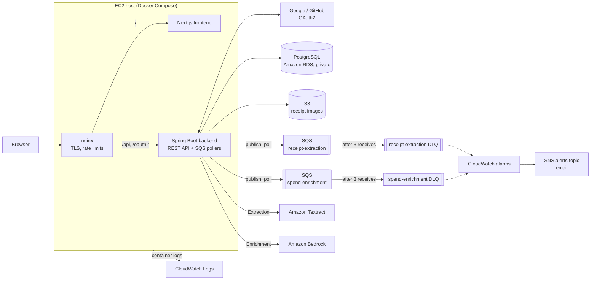

# SpendTracker

A personal expense tracker that turns a photo of a receipt into a categorized expense. Amazon Textract reads the receipt, and a model on Amazon Bedrock fills in the amount, date, items and category, guided by the user's own classification rules.

It is a full-stack app built and run in production on AWS by one developer: Spring Boot backend, Next.js frontend, and an asynchronous processing pipeline over SQS.

**Live:** <https://spendtracker.arielsoto.dev> (invite-only, see [Try it](#try-it)).

## What this project shows

- **Asynchronous, fault-tolerant processing.** Uploads return immediately. Two background stages, each behind its own SQS queue with a dead-letter queue, do the slow work. Delivery is at-least-once, so workers claim each job atomically, resume work interrupted by a crash, and a cleanup job catches anything that gets lost.
- **AI integration with cost control.** Textract and Bedrock are paid per use. Per-user and global monthly quotas keep the whole app inside the AWS free tier, and one Bedrock call does both extraction and classification to halve cost and latency.
- **Production on AWS, operated end to end.**
  - EC2, private RDS PostgreSQL, S3 and SQS.
  - CloudWatch Logs, and alarms that email through SNS.
  - Least-privilege IAM per environment, with no static keys in production.
- **Security.**
  - OAuth2 login with Google or GitHub.
  - CSRF protection.
  - An invite-only allowlist.
  - Rate limiting at nginx and in the backend.
  - Receipt files validated by their content, not their declared type.
- **Delivery.** CI runs unit tests and Testcontainers integration tests on every pull request. A push to `main` builds the Docker images and deploys them.
- **Documented decisions.** Architecture decision records, plus a runbook for every piece of infrastructure set up by hand.

## Architecture

A receipt goes through four steps:

1. **Upload.** The image is stored in S3, and the expense is saved as `PENDING` and queued.
2. **Extraction.** Textract reads the image into text.
3. **Enrichment.** Bedrock turns that text into the amount, date, items and category.
4. **Done.** The expense is `PROCESSED`. The frontend polls its status until then.

The details are in [How it works](docs/architecture.md).

## Tech stack

| Area | Technology |
| --- | --- |
| Backend | Java 21, Spring Boot 4 (Web MVC, Security, OAuth2, Data JPA), Flyway, PostgreSQL |
| Frontend | Next.js 16, React 19, TypeScript, Tailwind CSS |
| AWS | EC2, RDS, S3, SQS, Textract, Bedrock, CloudWatch, SNS, IAM |
| Testing | JUnit 5, Testcontainers |
| Delivery | Docker, GitHub Actions, GitHub Container Registry |

## Key decisions

- **Two SQS stages inside the existing backend, not Lambdas.** A new deployment unit was not worth it at this volume ([ADR 0001](docs/adr/0001-async-receipt-pipeline-sqs.md)).
- **No transactional outbox.** A scheduled job fails any expense stuck for 5 minutes, and the user retries it. This is simpler than an outbox, at the cost of a rare manual retry.
- **A recorded pipeline stage, so a redelivered message resumes interrupted work** instead of being dropped ([ADR 0002](docs/adr/0002-processing-stage-for-redelivery.md)).
- **Polling instead of WebSockets.** A few seconds of latency is fine for this use case.
- **Infrastructure set up by hand, with runbooks, instead of Terraform.** This was the simpler trade-off for a one-person project.

The reasoning behind each decision is in [How it works](docs/architecture.md#key-decisions-and-trade-offs).

## Try it

Login is invite-only, because the app calls paid AI services. To get access, ask the admin, [Ariel Soto](https://github.com/arielestebansoto), by [opening an issue](https://github.com/arielestebansoto/spendtracker/issues/new). To log in with GitHub, your email must be public on your GitHub profile.

To run it on your own machine, see [Local development](docs/local-development.md). It needs Docker, a few AWS resources and OAuth apps.

## Documentation

- [How it works](docs/architecture.md): the receipt pipeline, the decisions and trade-offs, the security model and deployment.
- [Local development](docs/local-development.md): setup, environment variables and tests.
- [Glossary](GLOSSARY.md): the domain language.
- [Architecture decision records](docs/adr).
- Operations runbooks:
  - [AWS IAM](docs/aws-iam.md)
  - [SQS queues](docs/sqs-provisioning.md)
  - [OAuth apps](docs/oauth-apps.md)
  - [Access allowlist](docs/access-allowlist.md)
  - [nginx](docs/nginx.md)
  - [Observability](docs/observability.md)
  - [Production database access](docs/production-database-access.md)

## Author

Built by [Ariel Soto](https://github.com/arielestebansoto).
